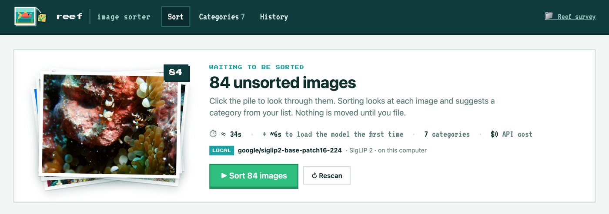
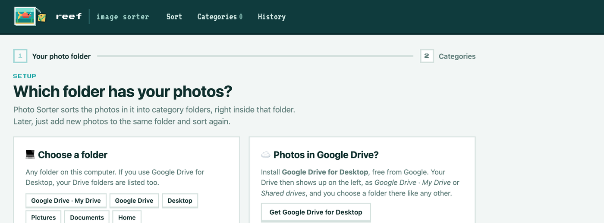
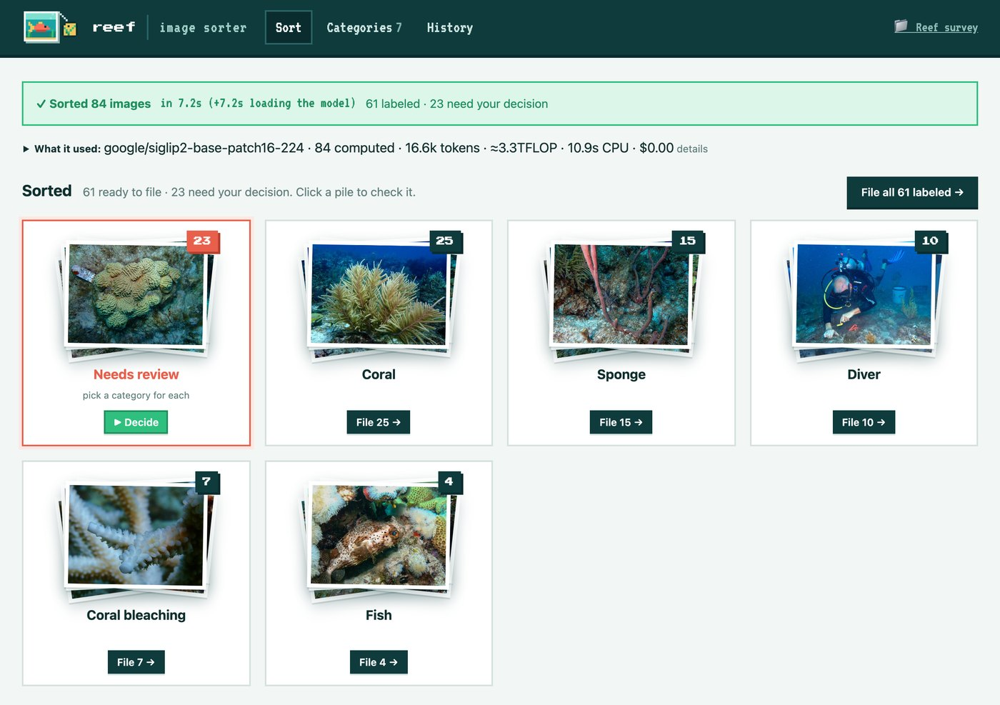
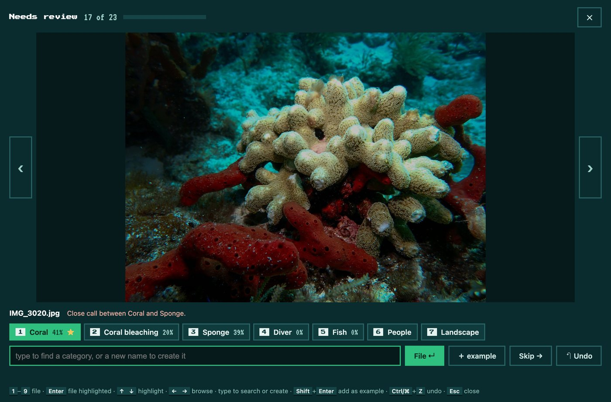

# Photo Sorter

**Sorts research photos into folders automatically, on your own computer.**



## What it is

Photo Sorter is a free app for research teams that take lots of photos, for example on a coral reef project.
You tell it which categories you use, and it files your photos into the right folders.

## What it does

- **Sorts** the photos in a folder into your categories: coral, sponge, diver, people, or whatever you choose.
- **Creates a folder for each category** and moves the photos into them with tidy names: `Coral/coral_001.jpg`.
- **Asks you when it isn't sure**, instead of guessing, and lets you decide with one key per photo.
- **Learns from you**: from your category descriptions, from example photos, and from every photo you file.
- **Can undo** every move.

## How it works

**1. Choose the folder that has your photos.** Any folder on your computer works, including Google Drive folders
through [Google Drive for Desktop](https://www.google.com/drive/download/).



**2. Press Sort.** In seconds, every photo gets a suggested category. Here, 84 photos from one week of reef work
were sorted in 7 seconds on a laptop: 61 were clear, and 23 wait for your decision.



**3. Check, then File.** Open a pile to check it, then press **File**. Photo Sorter creates a folder for each
category inside your photo folder and moves the photos into it:

```text
Reef survey/                        ← the folder you chose
├── Coral/
│   ├── coral_001.jpg
│   └── coral_002.jpg
├── Coral bleaching/
│   └── coral_bleaching_001.jpg
├── Sponge/
│   └── sponge_001.jpg
├── Diver/
│   └── diver_001.jpg
├── IMG_4207.jpg                    ← new photos wait here until the next Sort
└── CATEGORIES.md                   ← your category list, shared with everyone who opens the folder
```

With a nested list, folders nest too, for example `Photos - Coral/Outplants/APAL/apal_001.jpg`.
Later, just add new photos to the folder and press **Sort** again.

### Needs review: one key per photo

When Photo Sorter isn't sure, the photo waits in **Needs review**. Press **▶ Decide** to go through them one by
one: the photo shows large, with your categories as numbered tags and its best guess starred (★).



| Key | Does |
| --- | --- |
| `1`–`9` | file the photo into that category and move to the next one |
| `Enter` | accept the starred suggestion |
| type a few letters | find a category, or create a new one |
| `←` `→` | skip back and forth |
| `Shift` + `Enter` | add the photo as an **example** of the category, without moving it |
| `Ctrl`/`⌘` + `Z` | undo |

### It learns from you

Nothing needs to be "trained", and it gets better as you use it:

- **Your words.** Each category can have a short description of what its photos look like, for example
  *Sponge: sponge fragments on ropes underwater*. Photo Sorter compares every photo with these words.
- **Example photos.** Give a category 5 to 20 example photos (the 🖼 button on the **Categories** page: drop
  photos in, or search the web). New photos are compared with them. This is how it learns things words can't
  describe well, such as one coral species from another (APAL from ACER) or specific people.
- **Every photo you file.** Filed photos count as examples of their category too, so each decision you make
  teaches it. Changes apply on the next **Sort**.

### The model, and why

Photo Sorter uses **SigLIP 2** (`google/siglip2-base-patch16-224`), a free, open image-and-text model made by
Google. It runs on your own computer, so there's no account, no cost per photo, and your photos never leave
it. Because it understands pictures and words together, plain category descriptions work from day one, and
comparing new photos with your examples lets it learn without any training step. It's small enough for a laptop
(a 1.4 GB download, under a tenth of a second per photo on an Apple M1).

Large AI services such as Claude or Gemini could do this too, but they cost money per photo and need an account
and internet access; training a custom model needs thousands of labelled photos first.

## Install

You need a **Mac with an Apple chip** (M1 or newer) or a **Windows 10 or 11 PC**, about 3 GB of free space and an
internet connection. Nothing else: the installer brings its own copy of Python and everything it needs, keeps it all
inside your user folder, and doesn't need an administrator password.

### Mac

1. Open **Terminal**: press ⌘ + Space, type *Terminal* and press Enter.
2. Copy this line, paste it into Terminal and press Enter:

   ```bash
   curl -LsSf https://raw.githubusercontent.com/alegalguera/image-classification/main/install.sh | bash
   ```

3. It shows what it will install and where, then asks before it starts. Press Enter and wait for
   **✓ Photo Sorter is installed**. The first time takes a few minutes.

### Windows

1. Open **PowerShell**: press the Windows key, type *PowerShell* and press Enter. You don't need *Run as administrator*.
2. Copy this line, paste it into PowerShell (right-click pastes) and press Enter:

   ```powershell
   powershell -ExecutionPolicy ByPass -NoProfile -c "irm https://raw.githubusercontent.com/alegalguera/image-classification/main/install.ps1 | iex"
   ```

3. It shows what it will install and where, then asks before it starts. Windows may ask once for permission to add
   a free Microsoft component that Photo Sorter needs.

Either way, you now have a **Photo Sorter** icon on your Desktop. To update, paste the same line again.
You can read exactly what the installers do: [install.sh](install.sh) (Mac) and [install.ps1](install.ps1) (Windows).

## How to use it

### The first time

1. Double-click **Photo Sorter** on your Desktop. It opens in your web browser. A small window opens too: keep it
   open while you work, because closing it stops Photo Sorter.
2. **Choose the folder that has your photos.**
3. **Choose your categories:** use the folders already there, pick a ready-made list (*Coral reef restoration*, or
   the shorter *Reef basics*), or start empty. You can change the list any time on the **Categories** page.

### Every day

1. Add new photos to your photo folder.
2. Press **Sort**. Nothing moves yet; Photo Sorter only suggests.
3. Press **▶ Decide** for the photos in **Needs review**, and **File** for the piles that look right.

Changed your mind? Press **Undo**, or open **History** and use **Move to…** on any photo.

## Problems?

| What you see | What to do |
| --- | --- |
| The installer shows **✗** | It shows the last lines of its log. Send a screenshot to whoever helps you with Photo Sorter. |
| Windows says a script "is not digitally signed" | Don't run a downloaded file: paste the line from **Install** into PowerShell instead. |
| "This Mac has an Intel processor" | Photo Sorter needs a Mac with an Apple chip (M1 or newer) for now. |
| The page doesn't open, or says it can't connect | Double-click **Photo Sorter** again. |
| Almost everything lands in **Needs review** | Describe your categories and add example photos (see *It learns from you*). |

## Remove it

Your photos, their folders and your category lists are never touched. Paste this on a Mac:

```bash
curl -LsSf https://raw.githubusercontent.com/alegalguera/image-classification/main/uninstall.sh | bash
```

or this in PowerShell on Windows:

```powershell
powershell -ExecutionPolicy ByPass -NoProfile -c "irm https://raw.githubusercontent.com/alegalguera/image-classification/main/uninstall.ps1 | iex"
```

## More

- [Advanced guide](docs/ADVANCED.md): pasting Google Drive links instead of using Drive for Desktop, hosting on
  Google Cloud, the command line, settings, and how it works in detail.
- License: [MIT](LICENSE). Free to use, change and share.
